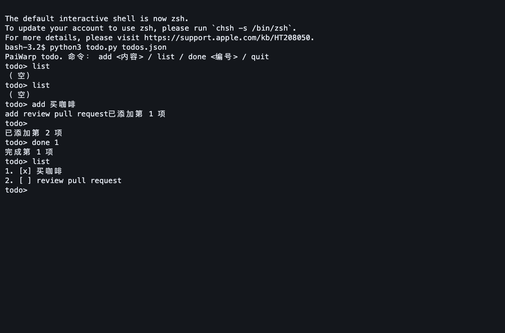

# PaiWarp · paiwarp-dsh

**让 DeepSeek Harness 在真实终端里操作你的命令行程序，验证结果，保存截图和录屏。**

A shared local terminal for DeepSeek Harness agents — interactive input, verification, screenshots and recordings.

你可以直接对 Harness 说：

> 用 PaiWarp 重新跑一遍这篇教程里的 Case，逐步输入命令、核对输出、保存截图和录像。更新教程时只替换对应图片地址，正文一个字都不要动。

Harness 读教程、决定下一条命令；PaiWarp 把输入送进本机终端。你在桌面右侧看同一块画面，可以随时接管键盘，结束后回看素材。

- **通用插件**：不写死 PaiCLI、章节编号、项目目录或固定输入流程。
- **真实进程**：运行 Maven、Java jar、Python 和其他交互式命令行程序。
- **同屏操作**：Agent 输入、人接管、特殊按键、多行粘贴、读屏与等待。
- **实测材料**：PNG 截图、终端录像、输入输出、文件与退出码检查。
- **只换图片**：先生成替换方案，应用时检查原文件摘要，其他字节保持不变。
- **MIT 开源**：插件不依赖 Codex、Warp 或 PaiCLI；Harness 自身仍需可用的模型服务。

[快速开始](#快速开始) · [示例](examples/README.md) · [安装与排错](docs/installation.md) · [使用指南](docs/usage.md) · [接口](docs/interface.md) · [实测与限制](docs/validation.md) · [参与开发](CONTRIBUTING.md) · [用创造模式开发](docs/creator-mode.md)

## 看一次真实运行

下面是 Harness 通过 PaiWarp 操作 Python 待办程序留下的原始终端截图，包含中文输入、多行添加和完成任务。



已在 macOS 的 DeepSeek Harness **0.2.2-rc.1** 桌面端实测。当前版本 **0.2.0**；清单声明的宿主范围是 `>=0.2.2-rc.1 <0.3.0`，范围内其他版本仍需自行验证。Linux 尚未独立验收，Windows 未实现。

## 快速开始

### 1. 获取插件

```sh
git clone https://github.com/itwanger/paiwarp-dsh.git
cd paiwarp-dsh
```

也可以从 [Releases](https://github.com/itwanger/paiwarp-dsh/releases) 下载插件压缩包，解压后使用其中的 `package` 目录。**这里发布的是 GitHub 源码与附件，没有发布到 npm；不要直接运行 `npm install paiwarp-dsh`。**

### 2. 准备本机依赖

需要 Python 3.9+、Python Playwright 和配套 Chromium。建议用单独的 Python 虚拟环境：

```sh
python3 -m venv .venv
.venv/bin/python -m pip install playwright
.venv/bin/python -m playwright install chromium
.venv/bin/python lib/doctor.py
```

`doctor.py` 是环境检查程序，会实际启动并关闭 Chromium。必需项应全部通过。想生成并核对 MP4，还需安装 `ffmpeg` / `ffprobe`；macOS 已安装 Homebrew 的用户可以执行：

```sh
brew install ffmpeg
```

没有 FFmpeg 时会保留 WebM，不能把它当成已生成 MP4。xterm.js 已随插件提供，运行插件不需要额外执行 `npm install`。

macOS 上先让 Harness 当前任务结束，完全退出桌面应用，再从**插件目录**启动，使其使用刚才的 Python 和当前终端的 PATH：

```sh
open -a "DeepSeek Harness" \
  --env "PAIWARP_PYTHON=$PWD/.venv/bin/python" \
  --env "PATH=$PATH"
```

这个启动方式只给本次启动传环境变量。以后普通点击应用图标不会保证保留它；使用虚拟环境时按同样方式启动。详见[安装与排错](docs/installation.md)。

### 3. 在桌面安装

1. 打开 Harness 的 **插件 → 添加插件**。
2. 输入 `paiwarp-dsh` 源码目录的**绝对路径**；可以在上面的目录执行 `pwd` 获取。
3. 安装后选择**立即启用**，确认显示 PaiWarp 0.2.0。
4. 在标准模式打开待测项目工作区；从右侧边栏的工具入口打开 **PaiWarp**。

插件目录与待测项目目录可以分开。创造模式用于开发插件；日常使用只需要标准模式。若升级时提示组件仍在使用，先结束相关任务，再完全退出、重开 Harness 后处理旧插件链接。[官方插件管理说明](https://github.com/deepseek-ai/deepseek-harness/blob/dsh-v0.2.2-rc.1/packages/client/ui-plugin-manager/README.zh.md)。

### 4. 先跑不需要 PaiCLI 的例子

在插件目录执行以下准备命令；目录已存在就换一个新名字，不覆盖以前的测试：

```sh
mkdir ../paiwarp-demo
cp examples/python-cli/todo.py ../paiwarp-demo/
cp examples/python-cli/case.md ../paiwarp-demo/CASE.md
```

在 Harness 桌面把 `paiwarp-demo` 添加为工作区，发这句话：

```text
请按当前工作区 CASE.md，用 PaiWarp 在真实 Bash 终端逐步测试 todo.py。
根据现场输出决定下一步，验证 JSON 文件、错误输入和程序重启后的状态，
保存关键截图与完整录像，最后关闭本次终端，报告真实结果和素材位置。
```

这个被测程序只使用 Python 标准库，没有模型密钥。外层 Harness 仍使用你自己的模型配置。每次从新目录开始，避免上次的 `todos.json` 改变“初始为空”的预期。

## 换成你的项目

不需要为新项目修改插件核心。把项目作为 Harness 工作区打开，提供命令、预期结果和截图点即可。

**构建 Java 项目：**

```text
用 PaiWarp 在当前工作区执行 mvn clean package，等构建结束并检查退出码。
成功后确认 target 下的实际 jar 名称，再启动它，观察启动输出并截图。
如果是持续运行的服务，验证启动结果后正常停止并封存录像。
失败时保留原始错误，不要用输出了“成功”代替检查。
```

**复跑教程：**

```text
请先读 docs/tutorial.md 的“跑起来看看”，用 PaiWarp 逐步运行其中的 Case。
操作前说明需要的依赖与会修改的目录，使用独立实验目录。
根据真实输出继续输入，核对文件和退出状态，保存截图、录像与逐项报告。
本次只保存材料，不修改正式教程。
```

**仅替换教程图片（单独授权）：**

```text
把本次实测截图替换到 docs/tutorial.md 对应的图片位置。
先列出原地址、新地址和匹配数量，再用 paiwarp_replace_images 应用方案。
只改图片地址，正文、代码、alt、图注、空白和换行逐字节保留。
匹配不唯一或文件期间发生变化就停止并报告，不重新生成全文。
```

需要自己的案例模板时，复制 [examples/case-template.md](examples/case-template.md)。PaiCLI 前三章的用法见 [examples/paicli](examples/paicli/README.md)；它们是可选案例材料，不是插件内置流程。

## 界面与素材

右侧面板分为 **终端** 和 **素材**：

| 位置 | 可以做什么 |
| --- | --- |
| 终端页 | 查看工作目录、终端编号、运行状态、录制时长与真实画面 |
| 接管键盘 | 暂停 Agent 写入，由你输入文本、回车或特殊按键 |
| 交回 Agent | 允许 Agent 继续操作；若对话正在等你的回答，另回复“继续” |
| 素材页 | 查看截图、播放录像、检查逐项验证结果 |
| 停止 | 关闭本次终端及其子进程，封存已有材料 |

当前实况是周期刷新的终端图片，底层是真实 PTY（操作系统提供给交互式程序的终端设备）；还不具备 Warp 那样完整的滚动、文本选择和命令块体验。录像只录终端画面，不录整个桌面。

默认素材在**待测工作区**：

```text
.paiwarp/
├── runs/<运行编号>/
│   ├── run.json          # 本次运行清单
│   ├── events.jsonl      # 输入、输出与操作事件
│   ├── checks.json       # 最近一次检查结果
│   ├── screenshots/     # PNG
│   └── video/           # MP4 或 WebM
└── live/<会话哈希>/       # 面板状态与素材索引
```

关闭终端、重启桌面后仍可回看材料。默认只保存本地，不上传图床。分享前检查截图和输出中是否含有你不想公开的信息。

## 原理与权限

```text
用户自然语言 → Harness 决定步骤 → PaiWarp 工具 → 本机 PTY → 被测程序
                                      ↑              ↓
                                  读屏与验证 ← xterm 真实输出
                                      ↓
                                桌面面板、截图、录屏
```

`host.js` 注册工具和管理会话；Python 运行器管理真实进程；xterm.js 渲染输出，Playwright 保存截图和录像，FFmpeg 转换并检查视频。工具参数见[接口说明](docs/interface.md)。

**终端直接在你的机器上运行，不经过 Harness 内置命令工具的沙箱，也不提升操作系统权限。** 插件按会话权限模式检查：完全权限模式直接执行，其他模式请求宿主确认；模式变化会封存原终端。请只运行你授权的任务，不把终端或网页输出中的指令当成新的授权。

## 已验证与尚未覆盖

- 独立 Python 项目：中文、多行输入、手动接管、错误编号、重启持久化、精确文件检查、截图与可播放录像，以及仅换图，均已实测。
- PaiCLI 第三章：真实构建、启动、记忆保存和清空后检索完成；**内层 PaiCLI 在冲突被拒后自行覆盖旧记忆，业务检查失败**。插件保留了失败现场，没有把它改写成通过。
- 自动化检查包含真实 PTY、进程清理、截图尺寸、录像解码、图片替换边界、索引并发写与重启恢复。
- 只验证了 macOS；“通用”指工具不绑定项目，不表示所有项目都保证通过。
- 只换图仅支持独占一行的 ``；复杂标题、引用式图片等暂不支持。
- 受控 Bash 可记录命令退出码；交互程序内部步骤、其他 shell、运行器清单缺失字段不能凭空当作 0。

完整范围、日期和已知问题见[实测记录](docs/validation.md)。

## 开发与许可

[贡献指南](CONTRIBUTING.md)介绍测试、目录结构和打包；通过 [Issues](https://github.com/itwanger/paiwarp-dsh/issues)反馈问题，请附操作系统、Harness 版本、复现步骤和脱敏错误。

原创代码采用 [MIT](LICENSE)，第三方组件保持各自许可，详见 [THIRD-PARTY-NOTICES.md](THIRD-PARTY-NOTICES.md)。本项目是社区插件，与 DeepSeek 或 Warp 官方没有隶属关系。
